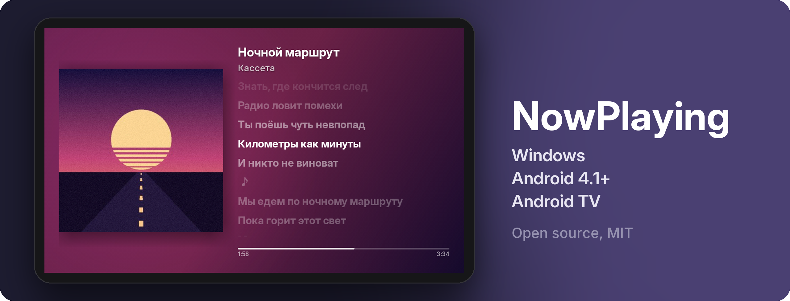

Делаем полезные экраны из старого железа, которое лежит в ящике. 
We turn old hardware from the drawer into useful screens.

 

**[NowPlaying](https://github.com/nowplaylab/nowplaying-display)**. Старый Android-планшет или телевизор показывает, что играет на компьютере: обложку, исполнителя и текст песни, где горит строка, которую сейчас поют. Когда музыка на паузе, на экране часы, погода и виджеты. 
An old Android tablet or TV shows what your PC is playing: the cover, the artist and the lyrics, with the line being sung lit up. When the music is paused, it shows the time, the weather and widgets.

[Сайт](https://nowplaylab.github.io/nowplaying-display/) &nbsp;&nbsp; [Скачать](https://github.com/nowplaylab/nowplaying-display/releases/latest) &nbsp;&nbsp; [Код](https://github.com/nowplaylab/nowplaying-display)

 

Делают <a href="https://github.com/tryshyzov">tryshyzov</a> и Claude &nbsp;/&nbsp; Made by <a href="https://github.com/tryshyzov">tryshyzov</a> and Claude

