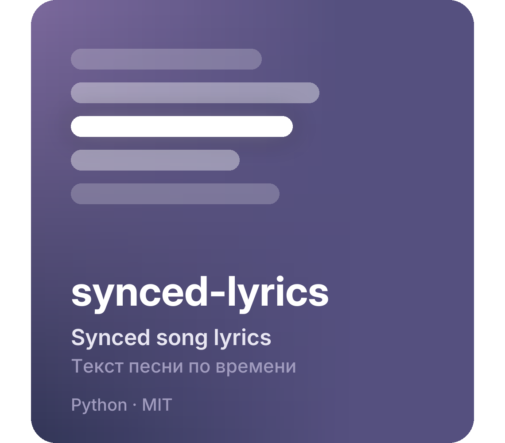
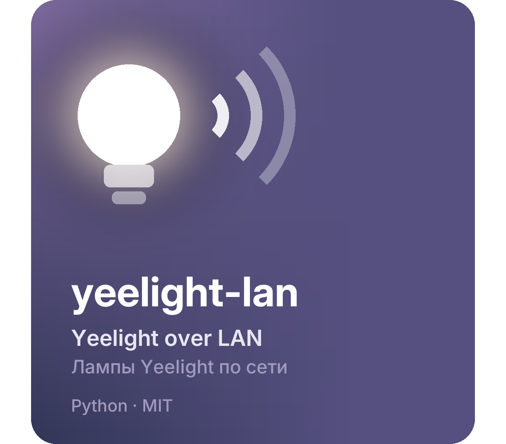
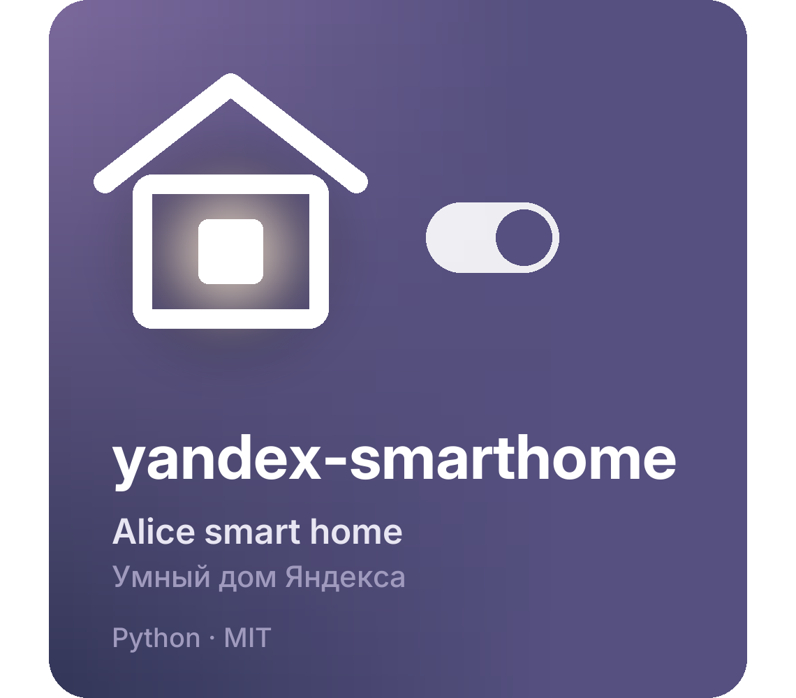

<p align="center">
We turn old hardware from the drawer into useful screens.<br>
<sub>Делаем полезные экраны из старого железа, которое лежит в ящике.</sub>
</p>

<br>

<a href="https://github.com/nowplaylab/nowplaying-display"></a>

**[NowPlaying](https://github.com/nowplaylab/nowplaying-display)**. An old Android tablet or TV shows what your PC is playing: the cover, the artist and the lyrics, with the line being sung lit up. When the music is paused, it shows the time, the weather and widgets.<br>
<sub>Старый Android-планшет или телевизор показывает, что играет на компьютере: обложку, исполнителя и текст песни, где горит строка, которую сейчас поют. Когда музыка на паузе, на экране часы, погода и виджеты.</sub>

<p>
<a href="https://nowplaylab.github.io/nowplaying-display/"></a>
<a href="https://github.com/nowplaylab/nowplaying-display/releases/latest"></a>
<a href="https://github.com/nowplaylab/nowplaying-display"></a>
</p>

<p>
<a href="https://github.com/nowplaylab/nowplaying-display/stargazers"></a>
<a href="https://github.com/nowplaylab/nowplaying-display/releases/latest"></a>
<a href="https://github.com/nowplaylab/nowplaying-display/blob/main/LICENSE"></a>
</p>

<br>

**Библиотеки** / Libraries<br>
The building blocks behind NowPlaying. Free to use in your own projects.<br>
<sub>Кусочки, из которых собран NowPlaying. Можно брать в свои проекты.</sub>

<p align="center">
<a href="https://github.com/nowplaylab/synced-lyrics"></a><a href="https://github.com/nowplaylab/yeelight-lan"></a><a href="https://github.com/nowplaylab/yandex-smarthome"></a>
</p>

<br>

**Поддержать** / Support<br>
Everything here is free and open source. If it helped you, you can chip in.<br>
<sub>Всё здесь бесплатное и с открытым кодом. Если пригодилось, можно закинуть на развитие.</sub>

<p>
<a href="https://www.donationalerts.com/r/tryshyzov"></a>
<a href="https://qr.crypt.bot/?url=TK787wDdmME8J6cpgLgqiaoV1EB6NK37hc"></a>
</p>

USDT, только сеть TRON (TRC20) / TRON network only:

```
TK787wDdmME8J6cpgLgqiaoV1EB6NK37hc
```

<br>

<p align="center"><sub>Делают <a href="https://github.com/tryshyzov">tryshyzov</a> и Claude &nbsp;/&nbsp; Made by <a href="https://github.com/tryshyzov">tryshyzov</a> and Claude</sub></p>
